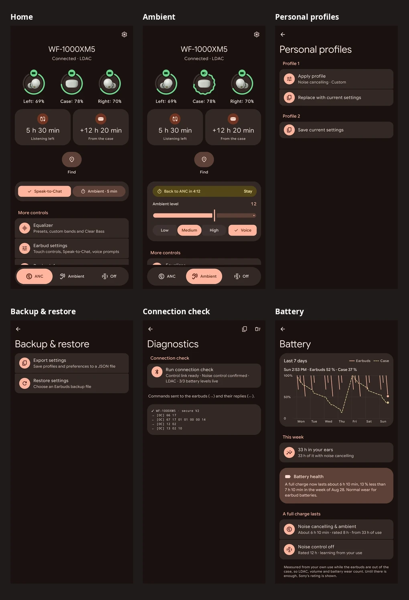

# Earbuds 2.0 review

This release combines roadmap 1.19 to 1.24 with the 2.0 verification and release work.
The app controls the paired Sony WF‑1000XM5 over Sony V2 RFCOMM. Android handles audio
and pairing. The app language is English.

| Roadmap | Entry points and evidence |
|---|---|
| 1.19 Foundation | `SonyConnection` handles ACKs. `CommandScheduler` owns the wire through read-back. `DeviceReads` coalesces polling and `Headphones` invalidates live state on disconnect. JVM tests cover overlapping requests and replacing a socket. |
| 1.20 Expressive Design System | `Theme`, `Components` and `Artwork` define palettes, type, shapes and symbols. Home uses green for normal battery readings. Launcher and splash share the coral case artwork. |
| 1.21 UX | Home distinguishes missing permissions, radio off, lost pairing, connecting and disconnected. The settings gear opens App settings. The bottom dock keeps three touch targets and shows icons at narrow widths or large font scales. |
| 1.22 Motion and haptics | `Navigation` implements Predictive Back and the Battery container transition. App haptics follow the app preference. See the physical 120 Hz scenario below. |
| 1.23 Pixel Native | Home-screen mode widget, optional Quick Settings tile, lock-screen dashboard on supported hosts, Android App Functions, Ambient Live Update and companion device presence. |
| 1.24 Intelligence | Battery shows remaining listening time and its estimate source. App settings exposes two personal profiles, an on-connect weekend rule and JSON backup. Diagnostics runs a bounded connection check. |
| 2.0 Final Polish | GitHub Actions builds and signs the optimized release. It runs JVM tests, lint, screenshot comparisons and an Android accessibility and startup smoke check. The physical checks below require a Pixel and paired WF‑1000XM5. |

## 1.24 scenarios

1. **Profiles:** connect, choose Ambient and set a level and voice focus. Save a personal
   profile, switch to ANC, then apply the profile. Check Ambient settings and any saved
   EQ settings. An unsuccessful read-back should produce a message.
2. **Routines:** set a weekend on-connect mode in App settings. Reconnect on a weekend
   and compare against weekday behavior. A configured home rule takes precedence
   when the phone has a recent enough location.
3. **Backup:** export JSON, change an appearance preference, then restore. Try a
   malformed file and check that the current preferences remain. The portable file
   contains the two profiles, wallpaper colors, haptics, Quick Settings cycle, the
   usual and weekend connection modes and the Ambient timer duration. Pairing, cached
   device readings, location and logs are device-local.
4. **Diagnostics:** App settings → Diagnostics → Run connection check. Check the
   summary for link, noise control, codec and the number of live battery readings.
   Repeat with Bluetooth disabled.

## Fresh screenshots

These are renders of the Compose screens using fixture data.

[Home](screenshots/home.webp) · [Ambient](screenshots/home-ambient.webp) ·
[Profiles](screenshots/page-profiles.webp) · [Backup](screenshots/page-backup.webp) ·
[Diagnostics](screenshots/page-diagnostics.webp) · [Battery](screenshots/page-battery.webp)

## Automated evidence

- [GitHub Actions](https://github.com/DKurocl/xm5/actions/workflows/build.yml) links every
  commit to its test results and screenshots. Open the run for the release commit.
- `Earbuds-visual-check` contains Android emulator captures, instrumentation output,
  cold launches and background-service checks. The debug scenes use fixture values.
- `Earbuds-screenshots` contains renders from the app's Compose UI and widget layouts.
  The reduced-size comparison images are in
  [app/src/screenshotTest/goldens](../../app/src/screenshotTest/goldens/).
- `Earbuds-checks` contains lint and JVM results. The signed APK is under
  [Releases](https://github.com/DKurocl/xm5/releases).

## Physical evidence to collect

| Check | Procedure |
|---|---|
| Bluetooth and device state | Confirm battery and codec, switch ANC → Ambient → Off rapidly, change mode on the earbuds, and reconnect twice. Test Ambient level and voice focus, custom EQ, touch settings and cached readings with the case closed. Record Pixel OS, earbud firmware and what the earbuds actually report. |
| Macrobenchmark and startup | Run `bash gradlew :benchmark:connectedBenchmarkAndroidTest` on a Pixel with a compatible release signing key. The benchmark reports cold startup with 10 iterations and the baseline profile. Run without an installed copy signed by a different key, or use the ADB timing fallback `bash docs/review/measure-startup.sh 10` against the installed release. Compare earbuds connected and away. |
| 120 Hz and gestures | Enable Smooth Display and confirm the actual display refresh rate. Reset `adb shell dumpsys gfxinfo ua.olex.sonyanc reset`, then switch modes, drag the Ambient slider and open/close the Battery page by tap and predictive swipe. Save `adb shell dumpsys gfxinfo ua.olex.sonyanc framestats`. Record missed deadlines and refresh rate during each operation. |
| 24-hour battery | Start with the case and buds charged, log levels, time, phone battery and Stay in sync state at 0 and 24 h. Note listening time, codec, ANC and connection time. For comparison, repeat with Stay in sync disabled using similar listening and charging behavior. Export Android battery statistics and record any background jobs or services. |
| Pixel integrations | Confirm widget operation at the preferred launcher size, Quick Settings, lock-screen host and Live Update. Check Gemini availability and confirmation on the target Pixel. Revoke Stay in sync and check that the link closes after the last action. |
| Accessibility | In addition to Android's automated audit, try 200% text, TalkBack focus order, descriptive mode states, and gesture cancellation on the physical device. |

Physical measurements were unavailable in this workspace. The hardware procedures above are
open review checks.
